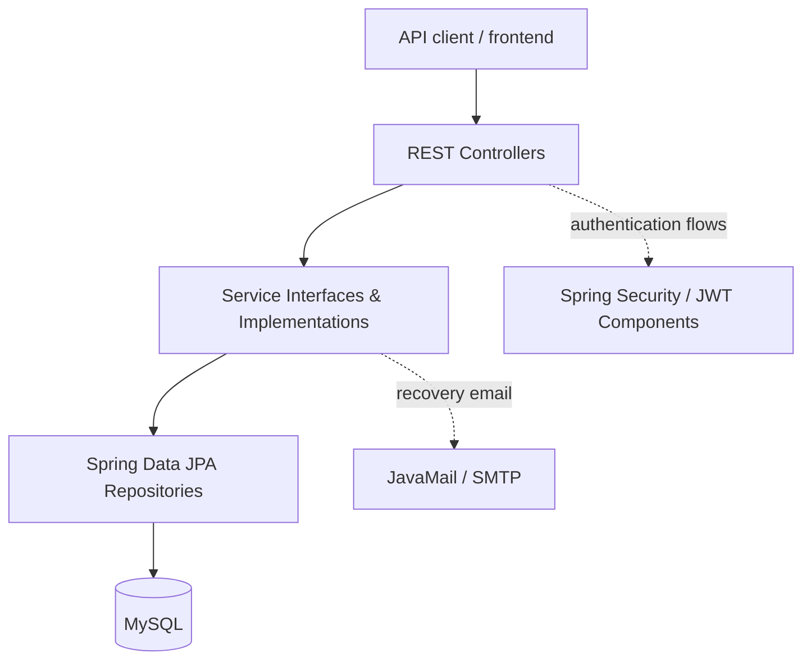
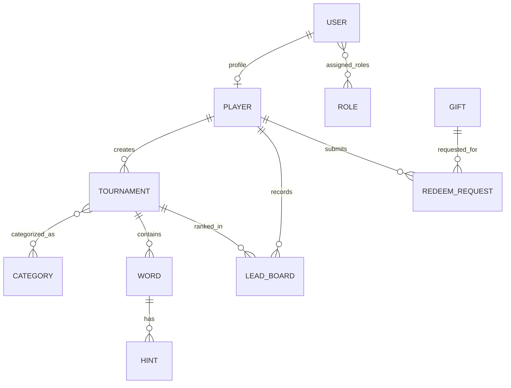

<div align="center">

# 🎮 HangMan

### A tournament-based word game backend built with Java and Spring Boot


**Players • Tournaments • Word challenges • Leaderboards • Rewards**

[Overview](#-overview) · [Architecture](#-architecture) · [Data Model](#-data-model) · [API Reference](#-api-reference) · [Getting Started](#-getting-started)

</div>

---

## 📖 Overview

HangMan is a **Java Spring Boot REST API project** that extends a word-guessing concept into a tournament-driven application. The backend models player accounts, tournaments, word-and-hint question sets, score tracking, leaderboards, and a coin-based gift redemption workflow.

This is an **earlier learning/portfolio project** preserved to demonstrate backend development with Spring Boot, layered application design, JPA entity relationships, and RESTful endpoints. It is **not a publicly hosted application**; the instructions below are for local development.

> **Scope:** This repository contains backend APIs and game-related data models. It should not be interpreted as a complete hosted game UI or a fully verified production deployment.

## ✨ Features

| Area | What the code implements |
| --- | --- |
| 👤 Player accounts | Sign-up, sign-in, player profiles, and login/logout-related endpoints |
| 🔑 Account recovery | Password recovery, reset, and OTP-related endpoints using mail support |
| 🏆 Tournaments | Create tournaments, browse available/self-created tournaments, stop or mark tournaments deleted, and review approvals |
| 🧩 Word challenges | Store tournament words and associated hints; return a word set with one randomly chosen hint per word |
| 📊 Leaderboards | Submit scores, retrieve results by tournament/player, and query leaderboard records |
| 🎁 Gifts & redemption | Maintain gift catalog, submit redemption requests, and update request status |
| 🛠️ Administration | List players, manage categories, and review pending tournament requests |

## 🧰 Technology Stack

| Layer | Technologies |
| --- | --- |
| Language | Java 8 |
| Framework | Spring Boot 2.7.6, Spring Web |
| Persistence | Spring Data JPA / Hibernate, MySQL |
| Security components | Spring Security, JWT (`jjwt`) |
| Validation & utilities | Bean Validation, Lombok, JavaMail |
| Build & tests | Maven, Spring Boot Test, Spring Security Test |

## 🏗️ Architecture

The code follows a **layered Spring Boot structure**. Controllers expose HTTP endpoints, services hold application logic, and Spring Data repositories handle persistence through JPA entities.



### Important packages

```text
src/main/java/com/coditas/HangMan/
├── HangManApplication.java
├── config/             # CORS and Spring Security configuration
├── controller/         # HTTP endpoints (7 controllers)
├── entity/             # JPA domain model (10 entities)
├── exception/          # Custom application exceptions
├── payload/            # Request/response DTOs
├── repository/         # Spring Data JPA repositories
├── security/           # JWT filter, token provider, user details
├── service/
│   ├── interfaces/     # Service contracts
│   └── impl/           # Service implementations
└── utils/              # Email and password encoder utilities
```

### Example request flows

**Tournament creation**

```text
POST /api/player/createTournament/{playerId}
  → PlayerController
  → TournamentServiceImpl
  → Tournament / Word / Category persistence via repositories
```

**Retrieving game questions**

```text
GET /questionSet/{tournamentId}
  → GameController
  → GameServiceImpl
  → Fetch tournament and its words
  → Select one random hint per word
  → Return List<WordDto>
```

**Recording a score**

```text
POST /api/addLeadBoard
  → LeadBoardController
  → LeadBoardServiceImpl
  → Persist a result associated with player and tournament
```

## 🗃️ Data Model

The repository defines **10 JPA entities**. Key relationships are represented below (simplified to show the core associations rather than every field or join table).



| Entity | Purpose |
| --- | --- |
| `User` | Account credentials, OTP field, and roles |
| `Role` | Role names for account associations |
| `Player` | Profile, game count, coin total, and linked user |
| `Tournament` | Tournament information, status, prize-coin values, and creator |
| `Category` | Categories associated with tournaments |
| `Word` | Tournament-specific words |
| `Hint` | Hints linked to words |
| `LeadBoard` | Player/tournament score, game duration, and play time |
| `Gift` | Redeemable items and coin value |
| `RedeemRequest` | Player gift requests and request status |

**Relationship highlights:** A player can create multiple tournaments; each tournament can contain multiple words; each word can have multiple hints; scores link players to tournaments; redeem requests link players to gifts. Tournament–category and user–role associations are many-to-many.

## 🔌 API Reference

These paths were read from the project's controller annotations. They document **routes present in the code**, not endpoints verified through a running deployment.

### Authentication & account recovery

| Method | Endpoint | Purpose |
| --- | --- | --- |
| `POST` | `/api/signUp` | Create player account |
| `POST` | `/api/signin` | Authenticate and return JWT response |
| `POST` | `/api/forgot` | Start password recovery flow |
| `POST` | `/api/verifyOtp` | OTP-related verification flow |
| `POST` | `/api/reset` | Reset password |

### Player & tournament operations

| Method | Endpoint | Purpose |
| --- | --- | --- |
| `GET` | `/api/player/availableTournaments/{playerId}` | List available tournaments |
| `GET` | `/api/player/selfCreated/{playerId}` | List tournaments created by player |
| `GET` | `/api/player/getSelfInfo/{playerId}` | Retrieve player information |
| `POST` | `/api/player/createTournament/{playerId}` | Create tournament |
| `PUT` | `/api/player/delete/{tournamentId}` | Mark tournament deleted |
| `POST` | `/api/player/stopTournament` | Stop tournament |
| `GET` | `/api/player/graph/{playerId}` | Retrieve player progress data |
| `GET` | `/api/player/getLeadBoardForParticularPlayer/{playerId}` | Retrieve player's leaderboard entries |
| `POST` | `/api/player/logout` | Player logout-related operation |
| `GET` | `/questionSet/{tournamentId}` | Retrieve word/hint question set |

### Scores & leaderboards

| Method | Endpoint | Purpose |
| --- | --- | --- |
| `POST` | `/api/addLeadBoard` | Submit leaderboard result |
| `GET` | `/api/getScoresForTournament/{tournamentId}` | View tournament scores |
| `GET` | `/api/getAllLeaderBoardList` | Retrieve leaderboard records with query filters |

### Admin & categories

| Method | Endpoint | Purpose |
| --- | --- | --- |
| `GET` | `/getPlayerList` | List player entities |
| `GET` | `/getPlayers` | List player DTOs |
| `GET` | `/getAllPlayers` | List player DTOs |
| `GET` | `/getCategoryList` | List categories |
| `POST` | `/addCategory` | Add category |
| `DELETE` | `/deleteCategory/{categoryId}` | Delete category |
| `GET` | `/getPendingTournamentRequests` | Retrieve pending tournament requests |
| `POST` | `/approveTournamentRequest` | Handle tournament approval |

### Gifts & redemption

| Method | Endpoint | Purpose |
| --- | --- | --- |
| `GET` | `/gifts/getGiftList` | List available gifts |
| `POST` | `/gifts/addGifts` | Add gift |
| `PUT` | `/gifts/updateGifts` | Update gift |
| `DELETE` | `/gifts/deleteGift/{giftId}` | Delete gift |
| `POST` | `/request/addGiftRequest` | Submit gift redemption request |
| `POST` | `/request/updateRequest` | Handle redemption request |
| `GET` | `/request/getGiftRequests` | List pending gift requests |

### Example payloads

**Sign in** — `POST /api/signin`

```json
{
  "userName": "sample_user",
  "password": "your_password"
}
```

**Create tournament** — `POST /api/player/createTournament/{playerId}`

```json
{
  "tournamentName": "General Knowledge Challenge",
  "firstPriceCoins": 100,
  "secondPriceCoins": 50,
  "thirdPriceCoins": 25,
  "categoryList": ["General Knowledge"],
  "wordDtoList": [
    {"wordName": "SPRING", "hintName": "Popular Java framework"}
  ]
}
```

**Add leaderboard result** — `POST /api/addLeadBoard`

```json
{
  "playerId": 1,
  "tournamentId": 1,
  "score": 80.0,
  "gameDuration": 120,
  "playTime": 1700000000000
}
```

> Payloads above illustrate DTO field names. Successful requests depend on existing database records, validation, and service behavior; the examples have not been integration-tested.

## 🚀 Getting Started

### Prerequisites

- JDK **8**
- Maven (or the included Maven wrapper)
- MySQL server
- An IDE such as IntelliJ IDEA or Eclipse (optional)
- SMTP configuration if testing email-based password recovery

### 1. Clone the repository

```bash
git clone https://github.com/Sanyami-Naik/hangman.git
cd hangman
```

### 2. Create a local MySQL database

```sql
CREATE DATABASE hangman;
```

### 3. Set local application configuration

The project reads its datasource, mail, and JWT configuration from `src/main/resources/application.properties`.

For a **local-only setup**, configure the relevant properties with your own database name and credentials, SMTP account (if needed), and a long private JWT secret. For example:

```properties
spring.datasource.url=jdbc:mysql://localhost:3306/hangman
spring.datasource.username=YOUR_LOCAL_DB_USER
spring.datasource.password=YOUR_LOCAL_DB_PASSWORD
spring.datasource.driver-class-name=com.mysql.cj.jdbc.Driver
spring.jpa.properties.hibernate.dialect=org.hibernate.dialect.MySQL8Dialect
spring.jpa.hibernate.ddl-auto=update

spring.mail.host=YOUR_SMTP_HOST
spring.mail.port=587
spring.mail.username=YOUR_SMTP_USERNAME
spring.mail.password=YOUR_SMTP_APP_PASSWORD
spring.mail.properties.mail.smtp.auth=true
spring.mail.properties.mail.smtp.starttls.enable=true

app.jwt-secret=REPLACE_WITH_A_LONG_PRIVATE_SECRET
app.jwt-expiration-milliseconds=86400000
```

These are **example values**, not the repository's original configuration. Do not commit real passwords or secrets. If existing secrets in repository history were genuine, rotate them before reusing those accounts—even if the app is no longer hosted.

### 4. Start the application

On macOS/Linux:

```bash
./mvnw spring-boot:run
```

On Windows:

```powershell
.\mvnw.cmd spring-boot:run
```

Or with an installed Maven CLI:

```bash
mvn spring-boot:run
```

Spring Boot typically serves requests at `http://localhost:8080` unless you configure another port. Example request path: `http://localhost:8080/gifts/getGiftList`.

### 5. Run tests

```bash
./mvnw test
```

The repository currently includes a Spring Boot application-context test. **There is no claim of full API or business-logic test coverage.**

## 🔐 Security & Project Status

JWT-related classes, password encoding, and Spring Security configuration are present in the code. **The current security configuration permits all routes (`/**`)**, so it should not be treated as enforcing authorization or admin-only access. Before deploying publicly, review endpoint authorization, JWT handling, input validation, error responses, secret management, and database access settings.

## 🧭 Possible Future Improvements

These are **ideas, not features claimed to be implemented**:

- Enforce role-based access for player and admin endpoints
- Move secrets to environment variables or a secrets manager
- Add OpenAPI / Swagger documentation
- Expand unit and integration tests for services and APIs
- Add database migrations and seed data for easier setup
- Build or connect a playable user interface
- Package the backend with Docker for reproducible local development

---

<div align="center">

**An exploration of Java backend design, relational data modeling, and tournament-based game workflows.**

Built with Java • Spring Boot • MySQL

</div>
